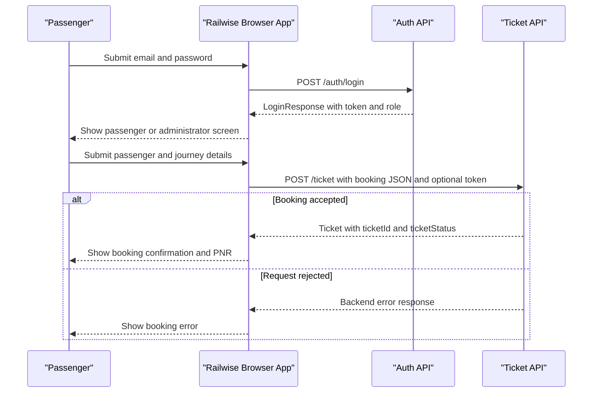

# API & Service Communication Contracts

This Angular application uses a JSON-over-HTTP REST API with 13 distinct endpoint/method combinations for authentication, train search and schedules, and ticket operations. The backend implementation and an OpenAPI specification are not present in this workspace, so request and response shapes below are inferred from the frontend client and user-provided backend behavior and should be confirmed with the API owner before third-party production integration.

## Service Catalog

| Service | Port | Category | Purpose |
|---|---:|---|---|
| Railwise Ticket Dashboard | Not configured in source | API Layer (client) | Browser application for passenger registration/sign-in, train search, ticket booking and management, and administrator schedule/ticket views. |
| Ticket REST API (external) | 8080 (development default) | API Layer / Business | Backend called by the browser application for authentication, train schedules, and ticket operations. Its implementation is not included in this repository. |

The browser client is an Angular application. `src/environments/environment.ts` sets the API base URL to `http://localhost:8080`; configure a reachable HTTPS base URL for a deployed environment. The Angular development server proxy is configured only for `/tickets`, `/ticket`, `/tdelete`, and `/tup`; it does not proxy all of the observed API paths. Current service calls use the absolute API base URL, so they go directly to that host rather than relying on the development proxy.

## API Endpoints Inventory

All paths below are relative to the API base URL. JSON is used for object and array requests/responses unless marked as plain text. No API versioning scheme or backend status-code contract is defined in this frontend repository; success status codes and error formats must be confirmed with the backend owner.

| Service | Method | Path | Request Type | Response Type |
|---|---|---|---|---|
| Auth API | POST | `/auth/login` | JSON body: `{ "email": "passenger@example.com", "password": "..." }` | `LoginResponse`: `{ token: string, role: string }` |
| Auth API | POST | `/auth/register` | JSON body: `RegisterRequest` (`fullName`, `email`, `phone`, `password`) | Plain-text response; body content is not specified by the client |
| Auth API | POST | `/auth/forgot-password` | JSON body: `{ "email": "passenger@example.com" }` | `ForgotPasswordResponse`: `{ message: string, resetToken: string \| null }` |
| Auth API | POST | `/auth/reset-password` | JSON body: `{ "token": "...", "newPassword": "..." }` | Plain-text response; body content is not specified by the client |
| Train API | GET | `/trains/search?source={source}&destination={destination}&journeyDate={journeyDate}` | Query parameters: `source`, `destination`, `journeyDate` (date string) | `TrainSchedule[]` including `availableSeats` and coach availability details when returned by the backend |
| Ticket API | GET | `/tickets` | No body or query parameters | `Ticket[]`; used by the passenger ticket view |
| Ticket API | GET | `/admin/tickets` | No body or query parameters | `Ticket[]`; used by the administrator ticket view |
| Ticket API | GET | `/ticket/{ticketId}` | Path parameter: numeric `ticketId` | `Ticket` |
| Ticket API | POST | `/ticket` | JSON body: passenger booking data (`name`, `dob`, `gender`, `doj`, `source`, `dest`, `trainNo`) | `Ticket` |
| Ticket API | POST | `/ticket/{ticketId}/cancel` | Path parameter: numeric `ticketId`; empty JSON object body `{}` | Updated `Ticket` |
| Train API | GET | `/admin/trains` | No body or query parameters | `TrainSchedule[]` |
| Train API | POST | `/admin/trains` | JSON body: train schedule data (`trainNo`, `source`, `destination`, `journeyDate`, `coaches[]`) | `TrainSchedule`; backend calculates available seats |
| Train API | PUT | `/admin/trains/{scheduleId}/coaches` | Path parameter: numeric `scheduleId`; JSON body: `CoachConfiguration[]` | Updated `TrainSchedule` |

The frontend's route-to-API mapping is:

| Browser screen | API operations |
|---|---|
| `/` (train search) | `GET /trains/search` |
| `/user-login` (also reached through `/login`) and `/admin-login` | `POST /auth/login` |
| `/register` | `POST /auth/register` |
| `/forgot-password` | `POST /auth/forgot-password`, then `POST /auth/reset-password` |
| `/booking` | `POST /ticket` |
| `/available-tickets` | `GET /tickets` for passengers or `GET /admin/tickets` for administrators; passenger cancel action uses `POST /ticket/{ticketId}/cancel` |
| `/admin` | `GET /admin/tickets`, `GET /admin/trains`, `POST /admin/trains`, `PUT /admin/trains/{scheduleId}/coaches` |

## Management & Observability Endpoints

| Service | Endpoint | Custom Metrics (if any) |
|---|---|---|
| Ticket REST API (external) | Not discoverable from this frontend repository | None discoverable |

No health, metrics, actuator, or API documentation endpoint is referenced by the client. This does not establish whether the external backend exposes one.

## DTOs & Contracts

- `RegisterRequest` is the registration request contract.
- `LoginResponse` is the login response contract. The client stores the `token` and `role`, and derives the display name from recognized JWT claims when possible.
- `ForgotPasswordResponse` is the password-reset request response contract. The UI expects a reset token to be returned in the response when one is issued.
- `TrainSchedule` is used as the schedule response and train-search result item. Schedule creation sends train details and coach configuration; `availableSeats` is calculated by the backend from coach count and seats per coach.
- `Ticket` is the booking response, ticket-list item, ticket lookup response, and cancellation response. Booking sends passenger/journey details without `ticketId`, `ticketStatus`, `coach`, or `berth`.
The TypeScript field types currently used by the client are:

| DTO | Field | Type | Notes |
|---|---|---|---|
| `RegisterRequest` | `fullName`, `email`, `phone`, `password` | string | All fields are submitted by the registration form; the UI requires a password of at least 8 characters. Confirm all server-side constraints with the backend. |
| `LoginResponse` | `token`, `role` | string | Login response fields expected by the client. |
| `ForgotPasswordResponse` | `message` | string | User-facing message returned by the reset-token request. |
| `ForgotPasswordResponse` | `resetToken` | string or null | The current UI consumes this value to submit the reset request. |
| `TrainSchedule` | `id`, `availableSeats` | number | Schedule identifier and backend-calculated seat total. The coach-update URL uses this `id` as its `scheduleId` path parameter. |
| `TrainSchedule` | `trainNo`, `source`, `destination`, `journeyDate` | string | `journeyDate` is submitted from an HTML date input. |
| Coach configuration | `coachType` | string enum | Supported types: `SL`, `3AC`, `2AC`, and `1AC`. |
| Coach configuration | `coachCount`, `seatsPerCoach` | number | The admin UI submits counts and seat capacity per coach; backend calculates the total available seats. |
| Coach response | `totalSeats` | number | Backend-derived coach capacity (`coachCount × seatsPerCoach`); used as a fallback when rendering per-type search results. |
| Booking request | `name`, `dob`, `gender`, `doj`, `source`, `dest`, `trainNo` | string | Required by the booking form; `dob` and `doj` are HTML date input values. |
| `Ticket` | `ticketId` | number | Shown to users as the PNR. |
| `Ticket` | `ticketStatus` | string enum in client | `Confirmed`, `RAC`, `Waitlisted`, or `Cancelled`. The backend value is normalized by the client. |
| `Ticket` | `coach`, `berth` | optional string | Client displays fallback values when either is missing. |

These are TypeScript interfaces, not runtime-validated schemas. No immutable DTO declaration, OpenAPI/Swagger document, GraphQL schema, or protobuf schema was found.
- The client consumes response JSON as typed objects and normalizes missing ticket status to `Confirmed`, missing coach to an em dash, and missing berth to `Not assigned`. A missing or unknown backend status can therefore appear as `Confirmed`; the API should return a defined status value.
- The UI presents `ticketId` as the PNR. It recognizes `Confirmed`, `RAC`, `Waitlisted`, and `Cancelled` ticket states, matching partial backend status strings case-insensitively.
- Form date values are sent as strings. Use ISO 8601 calendar dates (`YYYY-MM-DD`) for `dob`, `doj`, and `journeyDate`, consistent with HTML date inputs; confirm the backend's expected date format.

Illustrative booking request:

```http
POST /ticket
Content-Type: application/json
Authorization: Bearer <token>
```

```json
{
  "name": "Example Passenger",
  "dob": "1990-01-15",
  "gender": "Other",
  "doj": "2026-12-01",
  "source": "Delhi",
  "dest": "Mumbai",
  "trainNo": "12915"
}
```

Illustrative ticket response shape (field values are examples, not guaranteed backend values):

```json
{
  "ticketId": 12345,
  "name": "Example Passenger",
  "dob": "1990-01-15",
  "gender": "Other",
  "doj": "2026-12-01",
  "source": "Delhi",
  "dest": "Mumbai",
  "trainNo": "12915",
  "ticketStatus": "Confirmed",
  "coach": "B1",
  "berth": "24"
}
```

Illustrative train search request:

```http
GET /trains/search?source=Delhi&destination=Mumbai&journeyDate=2026-12-01
```

Illustrative administrator schedule request:

```http
POST /admin/trains
Content-Type: application/json
```

```json
{
  "trainNo": "12915",
  "source": "Delhi",
  "destination": "Mumbai",
  "journeyDate": "2026-12-01",
  "coaches": [
    { "coachType": "SL", "coachCount": 2, "seatsPerCoach": 72 },
    { "coachType": "3AC", "coachCount": 1, "seatsPerCoach": 64 }
  ]
}
```

The schedule-creation request supplies coach configurations in a `coaches` array with `coachType`, `coachCount`, and `seatsPerCoach`. It initializes seats-per-coach inputs to `SL: 72`, `3AC: 64`, `2AC: 54`, and `1AC: 24`; administrators can change these values.

Illustrative coach update request:

```http
PUT /admin/trains/123/coaches
Content-Type: application/json
```

```json
[
  { "coachType": "SL", "coachCount": 3, "seatsPerCoach": 72 },
  { "coachType": "2AC", "coachCount": 1, "seatsPerCoach": 54 }
]
```

The admin schedule screen lists coach counts and seats per coach from `GET /admin/trains` and submits coach-only changes as a JSON array to the update endpoint. The backend serializes the schedule key as `id`, although the coach-update URL names the path variable `scheduleId`. Train search results display total `availableSeats` and a per-coach-type seat count. The client uses a coach's `availableSeats` if supplied; otherwise it calculates the displayed coach seats as `coachCount × seatsPerCoach`. `GET /trains/search` must include a `coaches` array with coach details for per-type availability to appear. If the endpoint returns no coach details, the page displays the total only and explains the missing breakdown. Backend admin-only access control is required for `/admin/**`; the frontend's role-based screen check is not an authorization boundary.

Illustrative cancellation request:

```http
POST /ticket/12345/cancel
Content-Type: application/json
```

```json
{}
```

The frontend expects the cancellation response to be the updated ticket. The API method/path above is the current client contract; older `/tdelete/{ticketId}` and `/tup/{ticketId}` development proxy entries are not used by the current `TicketService`.

## Communication Patterns

- The browser calls the API synchronously using HTTP GET and POST. No message broker, asynchronous service-to-service protocol, or backend service discovery is represented in this repository.
- The API base URL is a frontend environment value. The checked-in value is the local development URL `http://localhost:8080`; it is not a suitable third-party or production URL.
- After login, the application stores the returned token in browser `localStorage`. The configured HTTP interceptor adds an Authorization header when a token is present. Confirm the exact header scheme expected by the backend and verify the deployed interceptor configuration before integrating.
- The user/admin distinction is selected from the `role` returned at login. The client performs UI-level role checks, but these do not secure endpoints; the backend must authenticate and authorize each protected operation, especially all `/admin/*` routes, ticket reads, booking, and cancellation.
- The train-search and authentication screens can be visited without a prior login. The frontend may still attach an existing token to their requests.
- No retry, timeout, circuit-breaker, bulkhead, or client-side load-balancing policy was found. The UI reports request failures but does not define a common API error schema.
- No TLS, CORS policy, backend authorization rules, or server-side authentication configuration can be verified from this frontend. Use HTTPS in deployed environments and confirm the backend's CORS allow-list and security policy.
- The reset-password UI expects the reset token in the API response. For production, confirm the backend's reset-token delivery and expiry design; returning reset tokens directly to clients may expose account recovery credentials.
- The application has no API version prefix. Coordinate any incompatible contract changes with the frontend before deployment.
- The current UI includes separate passenger and administrator sign-in flows, password recovery, passenger booking and cancellation, train search, and administrator schedule publication/ticket listing. The frontend checks the login `role` to decide which UI to show; these checks are not a substitute for API authorization.

## Service Technology Matrix

| Service | Web | Data Access | Discovery | Gateway | Actuator | Cache | Metrics |
|---|---|---|---|---|---|---|---|
| Railwise Ticket Dashboard | Angular SPA | None in browser client | None | None | None found | None found | None found |
| Ticket REST API (external) | REST API; backend framework unknown | Unknown | Unknown | Unknown | Unknown | Unknown | Unknown |

## Service Communication Sequence

The following summarizes the browser's observed authentication and booking flow. The backend is external to this workspace; authorization outcomes and HTTP status codes are not specified here.

<!-- mermaid-checked: every participant uses `participant Id as "Label"`, no \n in aliases/messages/notes, every alt/opt/loop closed by end, no `:` inside any alias -->

